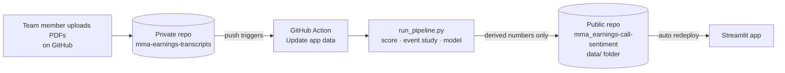

# Quanta-Mentals · Earnings Call Sentiment Analytics — Version 2: the story edition

> **Version 2.** This repository is the executive, story-first edition of the app. The analysis, data and pipeline are the same as
> version 1 ([`ranadera/mma_earnings-call-sentiment`](https://github.com/ranadera/mma_earnings-call-sentiment)); only the presentation differs.
>
> - **The story** (home page, `views/story.py`): one page an executive can read in about three minutes. Seven chapters: the question and the
>   short answer, what we listened to, script vs. live Q&A, banks vs. tech language, did the market listen, can you trade it, and what it means.
>   **Every headline, number and verdict is computed from `data/` when the page loads**; nothing is typed in by hand. If the data cannot support a
>   claim (too few calls, no prices, model not trained), the chapter says so instead.
> - **Try it:** *Analyze a call* opens in **Story mode** (`call_story.py`): the uploaded call told in plain language — a one-sentence summary,
>   what happened (words, speakers, questions), the most upbeat and most cautious management sentences quoted word for word from the file,
>   the overall mood against peers, script vs. live Q&A, what analysts pushed on (with the toughest question), how the stock reacted, and three
>   takeaways. Every sentence is a fixed template filled with computed numbers; no AI writes it. A switch at the top shows the **Full analysis**,
>   unchanged from version 1. Prof. Mehmet's bonus take (switch in `features.py`) appears in both views.
> - **Details:** every version 1 page (Overview, Benchmark explorer, Market reaction, Stock reports, Method & decisions), unchanged.
> - **Data updates:** the private transcripts workflow publishes the same derived scores to both repositories, so the two apps always show the same numbers.
> - **Link back to version 1:** set `V1_APP_URL` in `features.py`.
>
>
> **Version 2 add-ons and how to roll them back** (each is independent):
> - **Pre-call window:** `PRE_WINDOW_DAYS = 5` in `features.py` shows the 5 trading days before the call instead of the month before.
>   Set it to `21` to go back to the original month.
> - **First reaction vs. readjustment:** splits the 2-day reaction into the overnight jump (last close to next open) and the first
>   trading session (open to close), each against the market, using daily open/close prices (no intraday data needed). Files:
>   `gap_view.py`, `pipeline/gap_study.py`, `data/report_timing.csv`, `data/gap_study.csv`, `.github/workflows/gap-study.yml`
>   (rebuilds the data whenever the call scores change). Set `SHOW_GAP_STUDY = False` in `features.py` to hide it; delete those
>   files to remove it. Limit: with daily data the overnight jump contains the release and usually the call too.
> - **QR code and sample calls:** the Analyze page shows a QR code (`qr_card.py`, switch `SHOW_QR`; set `APP_URL` in `features.py`
>   to the public link) and a **Try a sample call** button that loads one of three synthetic practice transcripts in `samples/`
>   (invented wording, real ticker and date, so the real stock reaction is shown).
> - **Benchmark explorer (team feedback):** sectors first, a three-method comparison (bank-vs-tech gap and link to the 2-day move),
>   ranking by any method, script-vs-live and management-vs-analyst change bars, an average Q&A-start marker (`qa_start`, saved by the
>   pipeline) and stacked over-time charts by sector. Set `EXPLORER_V2 = False` in `features.py` to show the original page
>   (`views/explorer_classic.py`).
> - **Tone vs. the company's usual and timing (Section 5 feedback):** `tone_vs_usual` = a call's overall score minus the average of the
>   same company's earlier calls only (no look-ahead). Shown on the story page (chapter 5), in Story mode and as a row in the Market
>   reaction strategy table, which now labels its windows (days +2 to +5, +2 to +21) and adds 'bet against the overnight jump'.
>   Set `SHOW_TONE_SURPRISE = False` in `features.py` to hide the tone comparison.
> - **Full rollback:** the branch `backup/v2-before-gap-study` holds version 2 exactly as it was before these add-ons.
>
> Everything below describes the shared method and pipeline.

**MMA 823: Analytics for Financial Markets** · Smith School of Business, Queen's University
**Group 9:** Tanushi Khanna · Hannah Kwan · Joanna McFarlane · Shalini Prakash · Rushi Ranade · Jordan Sherwood

> **Research question.** Does the *language* of a quarterly earnings call, beyond the reported numbers, carry information about how the stock moves next? We build a repeatable pipeline that reads earnings call transcripts, measures sentiment in several ways, separates the scripted presentation from the live Q&A, and tests the signals against stock returns around each call.

Research prototype built for a course project. **Not investment advice.**

---

## Contents

1. [Project scope and where each part is delivered](#1-project-scope-and-where-each-part-is-delivered)
2. [End-to-end flow](#2-end-to-end-flow)
3. [Data](#3-data)
4. [Step 1 · Reading and structuring transcripts](#4-step-1--reading-and-structuring-transcripts)
5. [Step 2 · Measuring sentiment (Part 2)](#5-step-2--measuring-sentiment-part-2)
6. [Step 3 · Investor criticism and management strength (Part 3)](#6-step-3--investor-criticism-and-management-strength-part-3)
7. [Step 4 · Benchmark, overall score and signal](#7-step-4--benchmark-overall-score-and-signal)
8. [Step 5 · Sector dictionaries and peer groups](#8-step-5--sector-dictionaries-and-peer-groups)
9. [Step 6 · Stock price reaction: event study (Part 4)](#9-step-6--stock-price-reaction-event-study-part-4)
10. [Step 7 · Correlation and long-short strategy (Part 4)](#10-step-7--correlation-and-long-short-strategy-part-4)
11. [Step 8 · Predictive model: train on 2023, test on 2024](#11-step-8--predictive-model-train-on-2023-test-on-2024)
12. [Automated re-training flow (GitHub Actions)](#12-automated-re-training-flow-github-actions)
13. [The app (Part 5)](#13-the-app-part-5)
14. [Stock reports (Part 1)](#14-stock-reports-part-1)
15. [Current results](#15-current-results)
16. [Executive decisions](#16-executive-decisions)
17. [Assumptions](#17-assumptions)
18. [Limitations and next steps](#18-limitations-and-next-steps)
19. [Repository structure and how to run](#19-repository-structure-and-how-to-run)
20. [Validation and reproducibility](#20-validation-and-reproducibility)
21. [References](#21-references)

---

## 1. Project scope and where each part is delivered

| Part | Requirement | Where it is delivered |
|---|---|---|
| 1 | One-page stock reports | `stock_reports.ipynb` (PDF one-pagers) and the app's **Stock reports** page |
| 2 | Code to process transcripts; sentiment indicators; several methods explained | `sentiment_core.py`, `sentiment_analysis.ipynb`, `pipeline/run_pipeline.py`; app **Benchmark explorer** and **Method & decisions** |
| 3 | Investor criticism vs. management strength; presentation vs. Q&A; sentiment change through the call | Same code (Q&A measures, conviction score, 10-segment progression); app **Analyze a call** and **Benchmark explorer** |
| 4 | Prices ±1 month around each call; correlation with post-call returns; long-short strategy | `event_study.ipynb`, `pipeline/run_pipeline.py`, `market.py`; app **Market reaction** |
| 5 | Dynamic UI that takes a transcript as input | This Streamlit app (**Analyze a call**) |
| 6 | Report and presentation | Prepared separately by the team |

The Jupyter notebooks (`sentiment_analysis.ipynb`, `event_study.ipynb`, `stock_reports.ipynb`) hold the full analysis with commentary. They are kept with the team's project files because they run against the licensed transcripts. Every calculation in them is reproduced exactly by the code in this repository (see [Validation](#20-validation-and-reproducibility)).

---

## 2. End-to-end flow

```mermaid
flowchart LR
    A[Earnings call transcripts<br/>Bloomberg / LSEG PDFs] --> B[1 · Parse and structure<br/>speakers, roles, sections]
    B --> C[2 · Sentiment scoring<br/>LM dictionary, VADER, TextBlob]
    C --> D[3 · Call-level measures<br/>tone, Q&A shift, pushback,<br/>hedging, conviction, progression]
    D --> E[4 · Benchmark<br/>overall score and signal]
    E --> F[5 · Sector dictionaries<br/>and peer groups]
    F --> G[6 · Event study<br/>abnormal returns vs SPY / sector ETF]
    G --> H[7 · Correlation and<br/>long-short strategy]
    H --> I[8 · Predictive model<br/>train 2023, test 2024]
    I --> J[Streamlit app]
```



The same flow runs in two ways:

- **Notebooks:** step by step, with charts and written interpretation, for the report.
- **Automated pipeline:** `pipeline/run_pipeline.py` runs steps 1–8 in one command. A GitHub Action runs it automatically whenever new transcripts are uploaded (section 12).

---

## 3. Data

| Data | Source | Notes |
|---|---|---|
| Earnings call transcripts | Bloomberg and LSEG (Refinitiv) PDFs | Professor's benchmark: 22 calls (2024–2026, tech and banks). Team extension: 2023–2024 calls for Big Tech, large US banks and US regional banks. **Licensed: never published in this repository.** |
| Loughran-McDonald Master Dictionary | Loughran & McDonald (2011), via the `pysentiment2` package | Finance-specific positive, negative and uncertainty word lists |
| Daily prices | Yahoo Finance (`yfinance`), adjusted close | Stocks, SPY (S&P 500), XLK (tech ETF), KBE (bank ETF). Bloomberg prices can be supplied for delisted stocks |
| Company information | Yahoo Finance | Business description, sector and industry, valuation ratios |
| Sector map, sector dictionary, peer groups | Built by the team | `data/sector_map.csv`, `data/sector_lexicon.csv`, `data/peer_groups.csv` |

**Licensing.** Bloomberg transcripts state that reproduction or redistribution is prohibited. Transcripts therefore live only in a **private** repository. This public repository contains only derived numbers (scores, returns, prices), never transcript text.

---

## 4. Step 1 · Reading and structuring transcripts

Code: `sentiment_core.py` (`read_text`, `get_meta`, `parse`, `clean_lines`).

1. **Text extraction.** PDF text is extracted with `pypdf`. Page headers, footers, page numbers and copyright lines are removed, and accented characters are normalised.
2. **Metadata.** The ticker, company name and call date are read from the transcript header. Each call gets a `call_id` = ticker + date (e.g. `JPM_2026-04-14`), so a company with several calls is handled correctly. A file with no readable ticker or date is skipped and reported.
3. **Format detection and speaker parsing.** Three layouts are supported:
   - **Bloomberg:** speaker blocks marked with `{BIO … <GO>}` tags, `Q - ` / `A - ` prefixes in the Q&A, and a "Questions And Answers" heading.
   - **LSEG:** `CORPORATE SPEAKERS:` and `PARTICIPANTS:` lists, a `PRESENTATION:` heading, and "Name: text" turns.
   - **Plain text** (fallback for pasted text): split at a "Questions and Answers" heading if there is one.
4. **Roles and sections.** Each speaking turn is tagged with:
   - **role:** `management` (company executives), `analyst` (sell-side analysts and investors) or `operator`;
   - **section:** `presentation` (scripted remarks) or `qa` (live questions and answers).

   This gives three parts of every call: **presentation**, **analyst questions** and **management answers**.
5. **Cleaning.** Operator turns are dropped. Safe-harbour sentences (matching *forward-looking*, *safe harbor*, *differ materially* or *undue reliance*) are removed: every call opens with near-identical legal text full of negative words that says nothing about the quarter.

---

## 5. Step 2 · Measuring sentiment (Part 2)

Code: `sentiment_core.py` (`lm_counts`, `score_turns`, `summarise`). We use three methods because no single one is reliable on its own. Agreement between them gives confidence; disagreement is informative.

### 5.1 Loughran-McDonald (LM) finance dictionary: primary measure

The LM dictionary was built from 10-K filings, so it reads finance correctly: general tools treat words such as *liability*, *tax* or *cost* as negative, LM does not.

Every word of a turn is matched against the LM **positive**, **negative** and **uncertainty** lists, with two adjustments:

- **Negation rule:** a positive word preceded within three words by a negator (*not, no, never, none, neither, nor, without, isn't, wasn't, aren't, …*) counts as negative (e.g. "not strong").
- **"Question" excluded:** LM lists *question, questions, questioned, questioning* as negative (as in "called into question"). On a call they almost always mean "my question is…", and they were the most frequent "negative" words, so they are removed from the negative list.

Measures (per 100 words):

```
Tone          = (positive words − negative words) / total words × 100
Uncertainty   = uncertainty words / total words × 100
Negative rate = negative words / total words × 100
Polarity      = (positive − negative) / (positive + negative)        between −1 and +1
```

### 5.2 VADER: general-purpose cross-check

VADER (Hutto & Gilbert, 2014) is a rule-based sentiment tool for everyday English that handles negation, intensifiers ("very") and punctuation. Each sentence gets a compound score between −1 and +1. A turn's score is the average over its sentences; a call's score is the sentence-weighted average over its turns.

### 5.3 TextBlob: second cross-check

TextBlob scores the polarity of adjectives and phrases between −1 and +1. It is aggregated the same way as VADER.

### 5.4 FinBERT (optional)

FinBERT, a BERT language model fine-tuned on financial text, is an optional method in `sentiment_analysis.ipynb`; the notebook skips it if it is not installed. It is left out of the app and the pipeline to keep them small, fast and free of GPU requirements (see [Executive decisions](#16-executive-decisions)).

---

## 6. Step 3 · Investor criticism and management strength (Part 3)

Code: `sentiment_core.py` and `pipeline/run_pipeline.py`. Every measure is computed separately for the three parts of the call.

| Measure | Formula | Question it answers |
|---|---|---|
| Presentation tone | LM tone of the scripted remarks | How upbeat is the prepared message? |
| Q&A management tone | LM tone of management's live answers | Does management stay upbeat when questioned? |
| Analyst tone | LM tone of analyst questions | How positive are investors? |
| **Tone change into Q&A** (`tone_shift`) | Q&A management tone − presentation tone | Does the message hold up under questioning? Negative = softens when live |
| **Conviction gap** (`conviction_gap`) | Q&A management tone − analyst tone | Do answers sound more positive than the questions? |
| **Analyst pushback** (`analyst_neg_rate`) | Negative words per 100 words in analyst questions | How critical are investors? |
| Share of critical questions (`analyst_neg_share`) | Share of analyst turns with more negative than positive words | How many questions were critical? |
| **Hedging** (`hedging`) | Q&A uncertainty − presentation uncertainty | Does management become less certain when live? |
| **Management conviction** (`conviction_score`) | ( z(conviction gap) + z(tone change) − z(hedging) − z(analyst pushback) ) / 4 | One summary of management strength under scrutiny (z = standardised against the benchmark) |

**Sentiment change through the call (progression).** The cleaned text of each call is split into **10 equal-length segments** by word count (not by speaker, so every segment carries the same weight), and LM tone is computed for each segment. Two summaries:

- `call_drift` = average tone of the last 3 segments − average of the first 3: does the call end better or worse than it started?
- `qa_slope` = slope of a straight line fitted to the tone of management's Q&A answers in order (answers of 30 words or more): does tone fade as the questioning goes on?

The app also shows a **question-by-question** view: the tone of each analyst question and of management's reply, in order, with the toughest question flagged.

---

## 7. Step 4 · Benchmark, overall score and signal

A sentiment score only means something relative to other calls, so every score is compared with a **benchmark**: the professor's 22 calls, extended with the team's 2023–2024 calls as they are added.

```
z(x)          = (x − benchmark mean of x) / benchmark standard deviation of x
Overall score = mean( z(LM tone), z(VADER), z(TextBlob) )      (column: composite)
```

**Signal.** The overall score is split into terciles across the benchmark: bottom third **Negative**, middle **Neutral**, top third **Positive**. Terciles are used instead of fixed cut-offs because there is no natural threshold for "positive" language, and ranking is robust in a small sample.

A call uploaded in the app is scored with the same code and placed against the benchmark's mean, standard deviation and tercile cut-offs, so its numbers are directly comparable. When the benchmark has at least 3 calls in the call's sector, the call is also compared within its sector (`sector_composite`).

Summaries (NVIDIA's Bloomberg summary in the professor's set) are **excluded from the benchmark**: the words are Bloomberg's, not management's. The notebook scores them for reference only; the pipeline skips them.

---

## 8. Step 5 · Sector dictionaries and peer groups

**Problem.** A general finance dictionary misreads some routine sector jargon. Banks talk about *stress tests*, *provisions for credit losses* and *unemployment assumptions*; tech companies describe *mission-critical* systems and *high conviction*. Without adjustment, a whole sector looks more pessimistic than it is.

**Solution.** `data/sector_lexicon.csv` lists the terms that are routine in each sector, with the reason for each:

| Sector | Terms set aside | Why |
|---|---|---|
| All | closed, closing, against | Deals and quarters are "closed"; "against last year" is a comparison |
| Tech | critical, conviction, bridge | "Mission-critical", "high conviction", a product "bridge" |
| Bank | stress, volatility, unemployment, credit losses, credit loss | Regulatory and accounting terms |

The **sector-adjusted tone** (`lm_tone_sector`) is LM tone with these terms (single words and two-word phrases) set aside. Each call's sector comes from `data/sector_map.csv`. For a ticker not in the map, the app looks up its industry on Yahoo Finance, and the pipeline uses the transcript folder's name ("bank" → Bank, "tech" → Tech).

**Adding a sector** needs no code: add its tickers to `sector_map.csv` and its jargon to `sector_lexicon.csv`. The model stays small and transparent while adapting to each sector's language.

**Peer groups** (`data/peer_groups.csv`) split the benchmark further into **Big Tech**, **Large banks** and **Regional banks**, so the app can compare, for example, regional and large banks around the March 2023 regional banking crisis.

---

## 9. Step 6 · Stock price reaction: event study (Part 4)

Code: `pipeline/run_pipeline.py`, `market.py`, `event_study.ipynb`.

1. **Prices.** Daily adjusted closing prices from 60 days before the first call up to today, for every stock plus SPY, XLK and KBE. Each ticker is downloaded separately, with retries. Prices Yahoo no longer serves (delisted SVB and Comerica) can be supplied from Bloomberg in `extra_prices.csv`.
2. **Event window.** Day 0 is the call date (or the next trading day). The window runs from **−21 to +21 trading days**, about one calendar month on each side.
3. **Abnormal return** (market-adjusted model):

   ```
   AR(t)      = stock return(t) − benchmark return(t)
   CAR(a, b)  = sum of AR(t) for t = a … b
   ```

   Two benchmarks: **SPY** (did the stock beat the market?) and the **sector ETF**, XLK for tech or KBE for banks (did it beat its own sector?).
4. **Significance of the reaction** (Analyze a call): t = CAR(0,+1) / (σ × √2), where σ is the standard deviation of the stock's daily abnormal return over an **estimation window of days −120 to −22**, which does not overlap the event window (falls back to days −21 to −1 if there is too little history). |t| ≥ 1.96 is unusual at the 5% level, |t| ≥ 2.58 at the 1% level, assuming independent, normally distributed daily abnormal returns (Brown & Warner, 1985; MacKinlay, 1997).
5. **Windows reported:**

   | Column | Window | Meaning |
   |---|---|---|
   | `car_pre` | −21 to −1 | Month before the call: was sentiment already priced in? |
   | `car_day` | 0 to +1 | Immediate reaction |
   | `car_week` | 0 to +5 | First week |
   | `car_month` | 0 to +21 | First month |
   | `hold_week` | +2 to +5 | Tradable week (entry at the close of day +1) |
   | `car_drift` | +2 to +21 | Tradable month: post-call drift |

---

## 10. Step 7 · Correlation and long-short strategy (Part 4)

- **Correlation.** Spearman rank correlation between each sentiment measure (overall score, tone, tone change into Q&A, conviction, analyst pushback) and each return window, with p-values. Spearman is used because it is robust to outliers in a small sample.
- **Long-short strategy.** For a given signal, **buy** the Positive third of calls and **short-sell** the Negative third. Entry is at the **close of day +1**, so no information is used before it is public; holding period 1 week or 1 month; equal weights; hedged against the benchmark.
- **Reported:** average return of each leg, the long-short spread per trade, hit rates (share of longs that beat the market and of shorts that lagged it), and a Welch t-test comparing the long and short legs.
- **Signals tested:** overall sentiment, tone change into Q&A, management conviction.

---

## 11. Step 8 · Predictive model: train on 2023, test on 2024

Code: `train_model()` in `pipeline/run_pipeline.py`; section 6 of `event_study.ipynb`.

The correlations and the long-short test use all calls at once. A stricter test is whether a model trained on **earlier** calls can predict calls it has **never seen**.

| Item | Choice |
|---|---|
| Model | Logistic regression (scikit-learn), features standardised on the training set |
| Features | LM tone, sector-adjusted tone, overall score, tone change into Q&A, management conviction, analyst pushback, hedging |
| Targets | (1) **Reaction:** the stock beats the S&P 500 over days 0 to +1. (2) **Drift:** the stock beats the S&P 500 from day +2 to +21, which can be traded after the call |
| Split | **Time-based:** train on 2023 calls, test on 2024 calls. Calls from later years (the professor's 2026 calls) give a second out-of-sample check |
| Metrics | Test accuracy against a **naive baseline** (always predict the most common outcome in the training data); AUC; the test-year long-short spread (top third of predicted probability minus bottom third); model weights |

The time-based split avoids look-ahead bias: nothing from the test year is used in training. If the model does not beat the naive baseline, the honest conclusion is that sentiment does not predict returns out of sample in this data. That is a valid finding and is reported as such.

The model trains automatically once there are at least 20 training calls and 10 test calls with returns. Until then the app shows "Not trained yet".

---

## 12. Automated re-training flow (GitHub Actions)

Adding transcripts and re-training needs **no manual steps and no code**.



### Two repositories

| Repository | Visibility | Holds |
|---|---|---|
| `ranadera/mma-earnings-transcripts` | **Private** | Licensed transcripts, optional `extra_prices.csv`, the workflow `.github/workflows/update-app.yml` |
| `ranadera/mma_earnings-call-sentiment` (this repository) | Public | App code, pipeline code, derived scores in `data/` |

### What happens on each upload

1. A team member opens the private repository, goes to `transcripts/tech_2023_24/` or `transcripts/banks_2023_24/` (or a new folder), clicks **Add file → Upload files**, drags in the PDFs and commits.
2. The push triggers the **Update app data** workflow, which:
   1. checks out the transcripts and this repository's code;
   2. installs the packages in `requirements.txt` plus scikit-learn;
   3. runs `python pipeline/run_pipeline.py --transcripts … --out data --extra-prices …`, performing **steps 1 to 8** on **all** transcripts, so the benchmark is re-calibrated each time and every score stays comparable;
   4. commits the updated files in `data/` to this repository as `quanta-mentals-bot`;
   5. writes a summary (calls per dataset and sector, model results) to the run page.
3. Streamlit Community Cloud detects the commit and redeploys the app with the new benchmark, event study and model.

### Files the pipeline writes to `data/`

| File | Contents |
|---|---|
| `call_sentiment.csv` | One row per call: metadata, all sentiment measures, overall score, signal, peer group |
| `segment_tone.csv` | Tone of each of the 10 segments of every call |
| `prices.csv` | Daily adjusted closing prices used (lets the app work if Yahoo is unavailable) |
| `event_returns.csv` | CARs per call, against SPY and against the sector ETF |
| `event_paths.csv` | Daily abnormal returns from −21 to +21 for every call (for the charts) |
| `model_results.json` | Train and test years, accuracy, baseline, AUC, long-short spread, model weights |
| `model_predictions.csv` | Test-set predicted probabilities and actual outcomes |

### One-time setup (done)

- A fine-grained personal access token with **Contents: Read and write** on this repository only, stored in the private repository as the Actions secret `APP_REPO_TOKEN`.
- For delisted stocks: Bloomberg daily closing prices uploaded as `extra_prices.csv` (a `Date` column plus one column per ticker) in the private repository's root.

### Running the pipeline by hand

```bash
pip install -r requirements.txt scikit-learn
python pipeline/run_pipeline.py --transcripts path/to/transcripts --out data
# options: --no-prices (sentiment only), --extra-prices path/to/extra_prices.csv
```

Sub-folders of `--transcripts` become the `dataset` column (e.g. `benchmark`, `banks_2023_24`).

---

## 13. The app (Part 5)

A Streamlit multipage app in Queen's colours. Every technical term has a plain-English tooltip (dotted underline; hover for the definition), and there is a full glossary.

| Page | What it does |
|---|---|
| **Home** | Group 9, navigation, the brief, the four-step method and the headline findings |
| **Analyze a call** | Upload a PDF or paste text. Returns the signal, **top 3 takeaways**, tone, sector-adjusted tone, overall score, tone change into Q&A and conviction; tone by part of the call, tone through the call, sentiment fingerprint against the sector, question-by-question chart; live price reaction (day, week, month vs. SPY and the sector ETF); top words, sector jargon set aside, toughest analyst questions; CSV download |
| **Benchmark explorer** | Filters by peer group and year; ranking; method agreement; scripted vs. live tone; progression; analyst pushback vs. conviction; tone by quarter; full data table |
| **Market reaction** | Average CAR path by signal; correlation heatmap with p-values; long-short table; predictive model results |
| **Stock reports** | One-page profile for any ticker (section 14) |
| **Method & decisions** | Methods, measures, sector dictionaries, executive decisions, assumptions, limitations, next steps, glossary |

The sector of an uploaded call is detected automatically (the sector map first, then the Yahoo Finance industry) and can be overridden in the side panel.

**"Our view" on the price reaction (Analyze a call).** For each uploaded call the app gives a plain-English verdict on whether the call appears to have moved the stock:

1. **Significance test:** the t-statistic of the day 0 to +1 abnormal return (section 9). |t| < 1.96: "no statistically unusual reaction"; |t| ≥ 1.96: unusual at the 5% level; |t| ≥ 2.58: unusual at the 1% level.
2. **Direction test:** does the move match the call's signal (Positive tone and the stock beat the market, or Negative tone and it lagged)?
3. **Verdict:** *No statistically unusual reaction*, *Unusual reaction, in the direction of the tone*, *Unusual reaction, opposite to the tone*, or *Unusual reaction after a neutral-toned call*, plus context: the move in the month before the call (already priced in?), whether the move continued, faded or reversed in the first week, and whether it was company-specific or shared with the sector ETF.

**No AI or language model is used anywhere in the app.** Every number is computed by the code in this repository, and every sentence in "Our view" (and in the optional bonus section) is a fixed template selected by explicit rules from those numbers. Each analysed call shows its data sources with links to the Yahoo Finance price history of the stock, SPY and the sector ETF, and lets the user download the daily returns used, so any figure can be checked by hand. The verdict is explicitly an indication of **association, not causation**. The app states clearly that macroeconomic factors (rates, inflation, yields, currencies, geopolitics), company and industry news (earnings vs. expectations, guidance, rating changes, deals) and market factors (flows, index changes) are not analysed, and that this is a student research project, **not financial advice**.

---

**Optional bonus: "Prof. Mehmet's take".** At the end of *Analyze a call* there is a collapsed, light-hearted section (tagged *Subscribers only*) with an imagined take on the price reaction, written by Group 9 in the spirit of themes from the MMA 823 lectures: a Noise-o-meter (the reaction against a normal day's movement), the questions he would probably ask (priced in already? roulette wheel or Halley's Comet? the sound in the room in the Q&A, sector context such as credit spreads or the AI build-out, small-sample p-values, counting your trials) and a homework prompt. It does not quote the professor and is not endorsed by him. **To hide it:** set `SHOW_PROF_MEHMET = False` in `features.py`. **To remove it completely:** delete `prof_mehmet.py`, `features.py` and the marked block at the end of `views/analyze.py`.

## 14. Stock reports (Part 1)

- **App:** for any ticker, the business description, sector and industry; valuation ratios (market cap, P/E, forward P/E, P/B, EV/EBITDA, dividend yield, ROE, beta), with EV/EBITDA shown as n/a for banks, where it is not meaningful; two years of price history indexed against the S&P 500, with each earnings call marked by its signal; 1-year return, volatility, maximum drawdown and 52-week range; and the sentiment history of the company's calls.
- **Notebook:** `stock_reports.ipynb` produces a Letter-size PDF one-pager per stock with the same structure, with optional Bloomberg overrides (`bloomberg_inputs.csv`, marked * on the report).

---

## 15. Current results

*Professor's benchmark: 22 transcripts (18 tech, 4 banks), April 2024 to August 2026. These numbers update as the 2023–2024 transcripts are added.*

**Sentiment**

- Signals: 7 Positive, 7 Neutral, 8 Negative (terciles).
- The three methods broadly agree (Spearman correlation: LM vs. VADER 0.74, LM vs. TextBlob 0.68, VADER vs. TextBlob 0.55).
- **Tone softens in the live Q&A** in 16 of 22 calls (73%); the average tone change is −0.36 net positive words per 100.
- Banks sound more cautious on paper: average LM tone 0.72 vs. 1.42 for tech. Setting sector jargon aside raises bank tone to 0.88 and tech to 1.50, so jargon explains part of the gap but not all of it. Bank analysts are also more critical (0.76 vs. 0.36 negative words per 100).

**Market reaction** (abnormal return vs. S&P 500, average by signal)

| Signal | Days 0 to +1 | First week | First month |
|---|---|---|---|
| Positive | −0.12% | +2.67% | −0.16% |
| Neutral | −3.41% | −3.75% | −11.19% |
| Negative | −2.06% | −2.13% | +1.78% |

- Positive calls did best over the first day and the first week, but the relationship is weak and not statistically significant. The Spearman correlation of the overall score with the day 0 to +1 return is +0.14 (p = 0.52); for tone change into Q&A it is +0.23 (p = 0.31).
- With 22 calls this is expected: a real effect could exist, but the sample cannot confirm it. This is why we are extending the data to about 150 calls (2023–2024) and testing the model out of sample.

---

## 16. Executive decisions

| # | Decision | Reason |
|---|---|---|
| 1 | Finance dictionary (LM) as the primary measure | General tools misread finance terms; LM is transparent and widely used in finance research |
| 2 | Cross-check with VADER and TextBlob, combined as an average of z-scores | No single method is reliable; combining reduces method-specific noise |
| 3 | Remove safe-harbour disclaimers | Identical legal text full of negative words, with no information |
| 4 | Treat "question(s)" as neutral | The most frequent false "negative" word on calls |
| 5 | Relative signal (terciles), not fixed thresholds | No natural cut-off; robust in small samples |
| 6 | Separate the presentation, analyst questions and management answers | The scripted part is polished; the Q&A is where caution shows |
| 7 | Sector dictionaries and within-sector comparison | Avoid penalising a sector for its vocabulary; the model adapts to a new sector by editing a CSV |
| 8 | Market-adjusted abnormal returns, also against the sector ETF | Removes market-wide and sector-wide moves without estimating betas on a small sample |
| 9 | Strategy entry at the close of day +1 | Uses only public information; avoids look-ahead bias |
| 10 | Time-based train/test split for the model | Realistic: predicts the future from the past |
| 11 | Keep the model light (no GPU, no paid API) | Runs in seconds anywhere; easy to explain and audit; FinBERT and LLMs documented as upgrades |
| 12 | Summaries excluded from the benchmark | Bloomberg's words, not management's |
| 13 | Transcripts kept private; only derived scores published | Licensing |

---

## 17. Assumptions

- Transcripts are accurate and speaker labels are correct; any speaker who is not an analyst or the operator is management.
- The Q&A starts at the "Questions And Answers" heading, or at the first analyst question when there is no heading.
- ±21 trading days ≈ one calendar month; day 0 is the call date or the next trading day.
- Each stock moves one-for-one with its benchmark (market-adjusted model).
- No transaction costs, borrowing costs or position limits in the strategy.
- Tone is measured from the text only, not from voice.

---

## 18. Limitations and next steps

**Limitations**

- Small sample today (22 benchmark calls), clustered in the same weeks, so returns are not fully independent.
- Dictionaries count words: they miss context, sarcasm and negation beyond three words.
- Prices react mainly to the reported numbers and guidance. Tone is one input among many and does not cause price moves.
- Yahoo Finance data can be incomplete for delisted stocks.

**Next steps**

1. Add the 2023–2024 transcripts (in progress): about 150 calls, including regional vs. large banks around the March 2023 crisis.
2. **Control for the earnings surprise** (actual vs. consensus EPS from Bloomberg) to test whether tone adds information beyond the numbers.
3. **Change in tone** against the company's own previous call.
4. Apply the method to **central bank press conferences** after rate decisions, and compare the daily and weekly market reaction with earnings calls.
5. Context-aware models (FinBERT, large language models) alongside the dictionary.
6. Voice features (pauses, hesitation) and news and analyst-note sentiment.
7. Risk-adjusted strategy evaluation (Sharpe ratio, trading costs, Fama-French factors).

---

## 19. Repository structure and how to run

```
app.py                    page router (Streamlit multipage)
ui.py                     styling, components, glossary, team section
data_access.py            cached data loaders
market.py                 prices (Yahoo or saved file), event-study maths, stock statistics
sentiment_core.py         transcript parsing and scoring (shared by app, pipeline and notebooks)
views/                    one file per page: home, analyze, explorer, market_reaction, stocks, method
pipeline/run_pipeline.py  automated pipeline: steps 1–8
scripts/make_prices.py    saves a backup price file for offline demos
features.py               on/off switches for optional sections
prof_mehmet.py            optional bonus section (see section 13)
data/                     derived data only (see section 12)
requirements.txt          app dependencies (the pipeline also needs scikit-learn)
```

**Run the app locally**

```bash
pip install -r requirements.txt
streamlit run app.py
```

**Notebooks** (team project folder): run `sentiment_analysis.ipynb`, then `event_study.ipynb`, then `stock_reports.ipynb`, with the transcripts in `transcripts/<dataset>/`.

---

## 20. Validation and reproducibility

- The app, the pipeline and the notebooks share `sentiment_core.py`. Run on the 22 benchmark transcripts, the automated pipeline reproduces the notebook's results **exactly**: maximum difference 0 for tone, VADER, TextBlob, overall score, tone change, pushback, hedging, progression and sector-adjusted tone; 5.6 × 10⁻¹⁷ (rounding) for conviction; 100% agreement on signals.
- Uploading a benchmark transcript in the app gives the same scores as the notebook.
- Before real 2023–2024 data were available, the model code was tested on simulated data with a planted signal, which it recovered (AUC 0.71).
- Every pipeline run is logged in the private repository's **Actions** tab, with a summary of the calls processed and the model results.

---

## 21. References

All references and links were checked against the original sources.

- Araci, D. (2019). FinBERT: Financial sentiment analysis with pre-trained language models. arXiv:1908.10063. https://doi.org/10.48550/arXiv.1908.10063
- Bernard, V. L., & Thomas, J. K. (1989). Post-earnings-announcement drift: Delayed price response or risk premium? *Journal of Accounting Research*, 27, 1–36. https://doi.org/10.2307/2491062
- Brown, S. J., & Warner, J. B. (1985). Using daily stock returns: The case of event studies. *Journal of Financial Economics*, 14(1), 3–31. https://doi.org/10.1016/0304-405X(85)90042-X
- Hutto, C., & Gilbert, E. (2014). VADER: A parsimonious rule-based model for sentiment analysis of social media text. *Proceedings of the International AAAI Conference on Web and Social Media*, 8(1), 216–225. https://doi.org/10.1609/icwsm.v8i1.14550
- Loughran, T., & McDonald, B. (2011). When is a liability not a liability? Textual analysis, dictionaries, and 10-Ks. *Journal of Finance*, 66(1), 35–65. https://doi.org/10.1111/j.1540-6261.2010.01625.x
- Loughran-McDonald Master Dictionary with Sentiment Word Lists. Notre Dame Software Repository for Accounting and Finance. https://sraf.nd.edu/loughranmcdonald-master-dictionary/
- MacKinlay, A. C. (1997). Event studies in economics and finance. *Journal of Economic Literature*, 35(1), 13–39. https://www.jstor.org/stable/2729691
- TextBlob documentation. https://textblob.readthedocs.io
- Yahoo Finance historical prices, accessed with yfinance (open-source Python library, not affiliated with Yahoo; Yahoo's data is intended for personal use). https://github.com/ranaroussi/yfinance

---

*Quanta-Mentals · Group 9 · MMA 823: Analytics for Financial Markets · Smith School of Business, Queen's University*

## Balanced banks vs. tech

The data update runs the pipeline with `--balance-sectors`, so banks and tech have the same number of calls. The larger sector is trimmed: first calls dated outside the other sector's date range, then the oldest call of the company with the most calls. The run log lists every call left out ("Balanced out"). To use every call again, remove `--balance-sectors` from `.github/workflows/update-app-data.yml` in the private transcripts repo.
